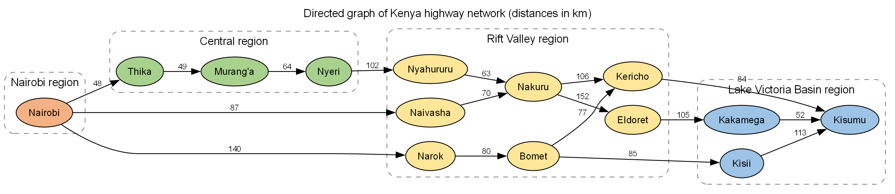
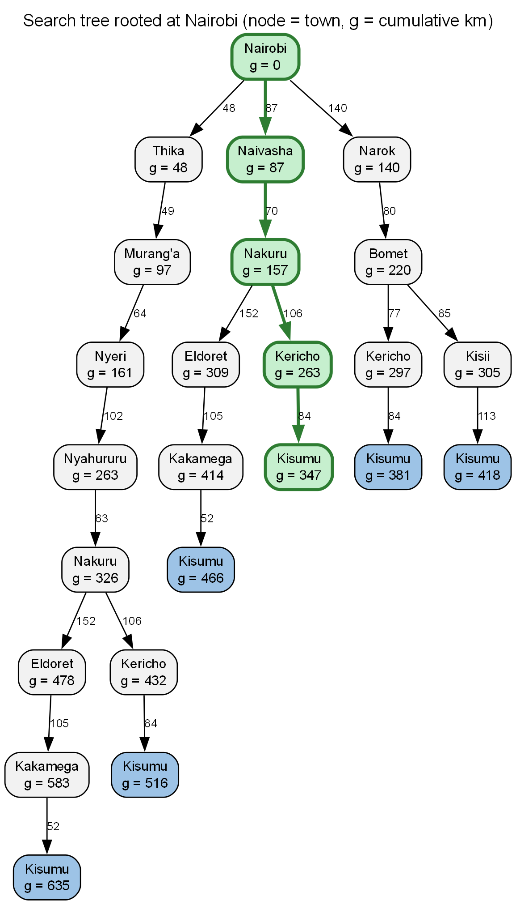
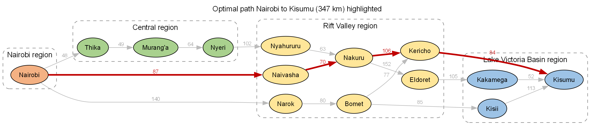
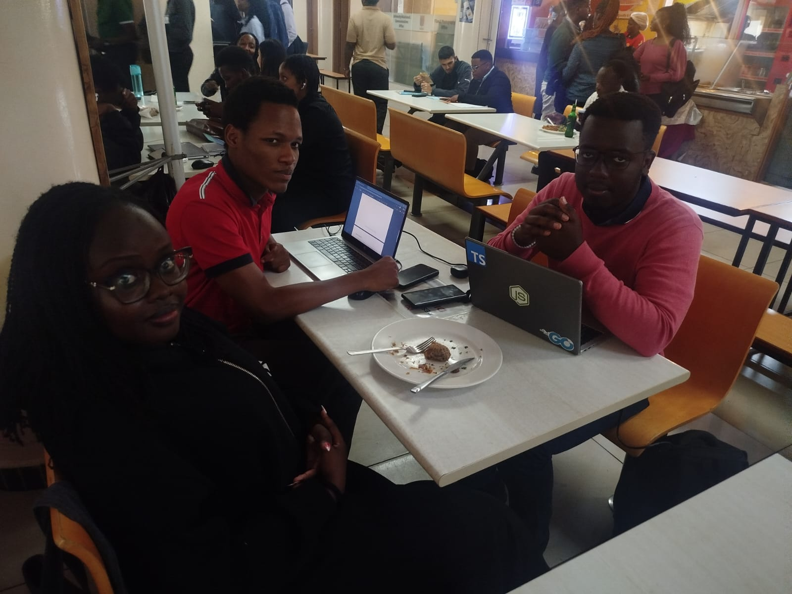

# ICS 3202: Artificial Intelligence – Practical Exercise 3
## Designing a Searching Agent: Self-Driving Trailer on Kenya's Highway Network

### Group Members
| # | Name | Admission No. |
|---|------|---------------|
| 1 | Kelvin Wambua Syengo | 189989 |
| 2 | Jason Wachira | 172995 |
| 3 | Chelsea Muegi | 187629 |

---

## 1. Agent Design Using the PEAS Framework

The self-driving trailer is a **goal-based (and utility-based) agent**. Its goal is to deliver cargo from an origin town to a destination town, and among the routes that achieve the goal it prefers the one with the lowest cost (distance, and by extension fuel and time) while staying safe and legal.

| PEAS element | Description for the self-driving trailer |
|---|---|
| **Performance measure** | Arrives at the correct destination (e.g. Kisumu); shortest distance / least fuel and travel time; safety – zero collisions, no harm to other road users; obeys traffic rules (speed limits, lanes, signs, axle-load limits at weighbridges); cargo delivered intact and on schedule; smooth driving and low wear on the truck |
| **Environment** | Kenyan highways (A104 Nairobi–Nakuru–Eldoret, B1 Nakuru–Kericho–Kisumu, B3 Mai Mahiu–Narok, A2 Thika Road); other vehicles (matatus, buses, cars, boda bodas, trucks); pedestrians, cyclists and livestock; potholes, speed bumps, roundabouts, escarpments (Kikuyu, Mau), road works; rain, fog (Timboroa / Mau Summit), night-time; police checkpoints, weighbridges, fuel stations |
| **Actuators** | Steering; accelerator and gear transmission; service brakes, engine/exhaust brake and trailer brakes; indicators, headlights, hazard lights, horn; display / radio link to dispatcher |
| **Sensors** | Cameras (lanes, signs, traffic lights); LiDAR and radar; GPS with digital road map; odometer and speedometer; IMU / accelerometer / gyroscope; load / axle-weight, tyre-pressure, engine and fuel sensors; ultrasonic sensors for reversing and docking |

### 1.1 Task Environment – the 5 Definitions

| Property | Classification | Justification |
|---|---|---|
| Fully vs. partially observable | **Partially observable** | Sensors cannot see around bends, over hills, through fog or beyond the next town. A crash or road block ahead is unknown until the agent is close. |
| Deterministic vs. stochastic | **Stochastic** | Other drivers, pedestrians, livestock, weather and tyre bursts mean the next state is not fully determined by the agent's action. |
| Episodic vs. sequential | **Sequential** | Every decision (which road to take at Nakuru, when to overtake) affects later states and the total trip cost. |
| Static vs. dynamic | **Dynamic** | Traffic moves, lights change and weather shifts while the agent is deliberating. |
| Discrete vs. continuous | **Continuous** | Position, speed, steering angle and time take continuous values. |

> **Note on abstraction:** for route planning we abstract this complex environment into a search problem. A state is simply *"the trailer is in town X"*, actions are *"drive to an adjacent town"*, and cost is road distance in km. In this abstract view the problem is **fully observable, deterministic, sequential, static and discrete**, so classical search algorithms apply. Low-level driving (lane keeping, braking) is handled separately by the agent's control layer.

### 1.2 Problem Formulation

| Component | Definition |
|---|---|
| Initial state | `In(Nairobi)` |
| States | `In(town)` for each of the 14 towns |
| Actions | `Go(next_town)` for every road leading out of the current town |
| Transition model | `Result(In(A), Go(B)) = In(B)` |
| Goal test | Current state = `In(Kisumu)` |
| Path cost | Sum of road distances (km) travelled |

---

## 2. Directed Graph and Search Tree

### 2.1 Towns Selected (by Region)

| Region | Towns (nodes) |
|---|---|
| Nairobi | Nairobi |
| Central Highlands | Thika, Murang'a, Nyeri |
| Rift Valley | Naivasha, Nyahururu, Nakuru, Narok, Bomet, Kericho, Eldoret |
| Lake Victoria Basin | Kisii, Kakamega, Kisumu |

### 2.2 Road Distances (Edge Costs)

Distances are driving distances between town centres calculated from OpenStreetMap road data using the OSRM routing engine (router.project-osrm.org), rounded to the nearest km.

| From | To | Distance (km) | Main road |
|---|---|---|---|
| Nairobi | Thika | 48 | A2 (Thika Superhighway) |
| Nairobi | Naivasha | 87 | A104 |
| Nairobi | Narok | 140 | A104 / B3 via Mai Mahiu |
| Thika | Murang'a | 49 | A2 / C71 |
| Murang'a | Nyeri | 64 | B21 via Sagana |
| Nyeri | Nyahururu | 102 | B5 |
| Nyahururu | Nakuru | 63 | B5 |
| Naivasha | Nakuru | 70 | A104 |
| Nakuru | Eldoret | 152 | A104 via Timboroa |
| Nakuru | Kericho | 106 | B1 via Londiani |
| Narok | Bomet | 80 | B3 |
| Bomet | Kericho | 77 | B3 / C23 |
| Bomet | Kisii | 85 | B3 via Sotik |
| Kericho | Kisumu | 84 | B1 via Ahero |
| Kisii | Kisumu | 113 | A1 via Oyugis |
| Eldoret | Kakamega | 105 | A1 / B39 |
| Kakamega | Kisumu | 52 | A1 |

### 2.3 Directed Graph

Each node is a town; each directed edge is a highway segment labelled with its distance. Real roads are two-way, but edges are directed outward from Nairobi toward the Lake Victoria Basin because the trailer's task is a westbound journey – this removes pointless back-tracking (cycles) from the search space.

### 2.4 Search Tree and Abstraction

**Abstraction** means removing details that are irrelevant to the problem so that it becomes solvable. In building the tree we:

- **Kept** only major towns (decision points where the trailer can choose a different road) and the distances between them.
- **Removed** small trading centres along each road (e.g. Kikuyu, Limuru, Gilgil, Molo, Londiani, Ahero, Mai Mahiu), traffic, weather, fuel stops, road quality, speed and lane-level manoeuvres – none of these change which town the trailer reaches next.
- Represented each state only by the town name; each tree node also records `g(n)`, the cumulative path cost from Nairobi.

The tree is rooted at the initial state (Nairobi) and every branch ends at the goal (Kisumu). The same town (e.g. Nakuru, Kericho) can appear more than once because it can be reached by different paths with different costs. The optimal branch is highlighted in green.

---

## 3. Optimal Path from Nairobi to Kisumu

Because path cost is the distance between towns and all step costs are positive, we use **Uniform Cost Search (UCS)**. UCS always expands the frontier node with the lowest path cost `g(n)`, so the first time the goal is selected for expansion it lies on the cheapest path (UCS is complete and optimal).

### 3.1 All Possible Routes

| # | Route | Calculation | Total (km) |
|---|---|---|---|
| 1 | Nairobi → Naivasha → Nakuru → Kericho → Kisumu | 87 + 70 + 106 + 84 | **347** |
| 2 | Nairobi → Narok → Bomet → Kericho → Kisumu | 140 + 80 + 77 + 84 | 381 |
| 3 | Nairobi → Narok → Bomet → Kisii → Kisumu | 140 + 80 + 85 + 113 | 418 |
| 4 | Nairobi → Naivasha → Nakuru → Eldoret → Kakamega → Kisumu | 87 + 70 + 152 + 105 + 52 | 466 |
| 5 | Nairobi → Thika → Murang'a → Nyeri → Nyahururu → Nakuru → Kericho → Kisumu | 48 + 49 + 64 + 102 + 63 + 106 + 84 | 516 |
| 6 | Nairobi → Thika → Murang'a → Nyeri → Nyahururu → Nakuru → Eldoret → Kakamega → Kisumu | 48 + 49 + 64 + 102 + 63 + 152 + 105 + 52 | 635 |

### 3.2 Uniform Cost Search Trace

Numbers in brackets are `g(n)` in km; the frontier is a priority queue ordered by `g(n)`.

| Step | Frontier (priority queue) | Node expanded | Action |
|---|---|---|---|
| 1 | Nairobi(0) | Nairobi(0) | add Thika(48), Naivasha(87), Narok(140) |
| 2 | Thika(48), Naivasha(87), Narok(140) | Thika(48) | add Murang'a(97) |
| 3 | Naivasha(87), Murang'a(97), Narok(140) | Naivasha(87) | add Nakuru(157) |
| 4 | Murang'a(97), Narok(140), Nakuru(157) | Murang'a(97) | add Nyeri(161) |
| 5 | Narok(140), Nakuru(157), Nyeri(161) | Narok(140) | add Bomet(220) |
| 6 | Nakuru(157), Nyeri(161), Bomet(220) | Nakuru(157) | add Eldoret(309), Kericho(263) |
| 7 | Nyeri(161), Bomet(220), Kericho(263), Eldoret(309) | Nyeri(161) | add Nyahururu(263) |
| 8 | Bomet(220), Kericho(263), Nyahururu(263), Eldoret(309) | Bomet(220) | add Kericho(297), Kisii(305) |
| 9 | Kericho(263), Nyahururu(263), Kericho(297), Kisii(305), Eldoret(309) | Kericho(263) | add Kisumu(347) |
| 10 | Nyahururu(263), Kericho(297), Kisii(305), Eldoret(309), Kisumu(347) | Nyahururu(263) | no successors |
| 11 | Kericho(297), Kisii(305), Eldoret(309), Kisumu(347) | Kericho(297) | already explored, skipped |
| 12 | Kisii(305), Eldoret(309), Kisumu(347) | Kisii(305) | add Kisumu(418) |
| 13 | Eldoret(309), Kisumu(347), Kisumu(418) | Eldoret(309) | add Kakamega(414) |
| 14 | Kisumu(347), Kakamega(414), Kisumu(418) | Kisumu(347) | GOAL reached |

### 3.3 Result

**Optimal path: Nairobi → Naivasha → Nakuru → Kericho → Kisumu**

**Total distance: 87 + 70 + 106 + 84 = 347 km**

The next-best route, Nairobi → Narok → Bomet → Kericho → Kisumu, is 381 km (34 km longer). The Central Highlands route via Thika and Nyeri is the longest (516 km and 635 km) because it detours north before turning west. This matches the standard Nairobi–Kisumu route for heavy vehicles: the A104 to Nakuru, then the B1 through Kericho and Ahero.

---

## 4. Evidence of Group Work

*Kelvin Wambua Syengo, Jason Wachira and Chelsea Muegi working on the exercise*

### Meeting Minutes

| Item | Details |
|---|---|
| Date / time | 16/10/2026, 1:00 PM |
| Venue | Strathmore University |
| Present | Kelvin Wambua Syengo, Jason Wachira, Chelsea Muegi |
| Agenda | 1. PEAS design and environment properties 2. Select towns and get road distances from OpenStreetMap 3. Draw directed graph and search tree 4. Run Uniform Cost Search and confirm optimal path 5. Set up PS-Agents repo and design.md |
| Work done | All agenda items were discussed and completed jointly by the three members during the session |
| Decisions | Use 14 major towns; direct edges westward from Nairobi; use UCS with OpenStreetMap road distance as path cost |
| Next steps | Each member forks the repo and reviews design.md before submission |
